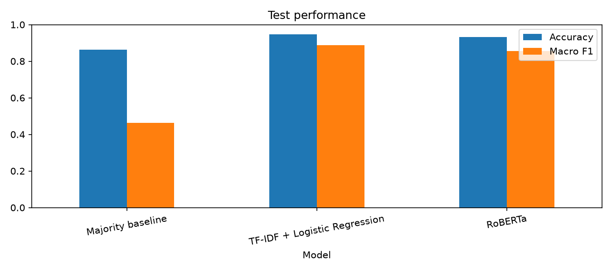

# Hotel Review Sentiment Analysis

An NLP course project comparing **TF-IDF + Logistic Regression** with **pretrained
RoBERTa** for binary sentiment classification of English hotel reviews. The main
question is which method achieves higher macro F1 on reviews containing negation,
such as "not clean" or "wasn't bad".

The experiment and saved notebook outputs are complete. **The report and
presentation are still pending.**

## Files

- `Hotel_Sentiment_Final.ipynb`: the complete experiment, saved outputs, and a new-review demo.
- `requirements.txt`: Python dependencies.
- `result/`: development searches, split counts, test metrics and predictions, error examples, and PNG graphs.
- `VERIFICATION.md`: execution and consistency checks.
- `LICENSE`: the original MIT license and copyright notice.

## Setup and run

Verified with Python 3.13.9 on Windows. From the project folder, run:

```powershell
python -m venv .venv
.\.venv\Scripts\python.exe -m pip install -r requirements.txt
.\.venv\Scripts\python.exe -m jupyterlab Hotel_Sentiment_Final.ipynb
```

In JupyterLab, select **Run > Run All Cells**. In VS Code, choose
`.venv\Scripts\python.exe` as the notebook kernel. Restart the kernel after
installing missing libraries. Run cells in order from the project folder.
On macOS/Linux, use `.venv/bin/python` for the environment's Python command.

The first run needs internet access for the dataset and model weights. Later runs
reuse the local CSV and `.cache/huggingface` model files. CPU and CUDA GPU are
supported; a full CPU run can take several minutes. Edit `new_review` in the final
demo cell to classify another review after the earlier cells have run.

## Dataset

Source: [Datafiniti Hotel Reviews on Kaggle](https://www.kaggle.com/datasets/datafiniti/hotel-reviews).
The notebook uses **`Datafiniti_Hotel_Reviews.csv`**, which contains 10,000 rows.
It downloads and extracts that file automatically if it is missing. Alternatively,
download it from Kaggle and place it beside the notebook. The raw dataset is
excluded from this repository; `result/*.csv` are included experiment
outputs, including the test review text and predictions.

Cleaning removes missing or blank reviews, invalid ratings, middle ratings, and
normalized duplicate text. Ratings from 1 to 2 are Negative; ratings from 4 to 5
are Positive. Ratings between 2 and 4 are excluded without rounding. Duplicate
groups with conflicting labels are removed. Unicode, apostrophes, case, and spaces
are normalized for duplicate checking; models receive the original trimmed text.

There are **8,422 cleaned reviews**: 1,152 Negative and 7,270 Positive. The fixed,
stratified split uses seed 42:

| Split | Reviews | Negative | Positive |
|---|---:|---:|---:|
| Training | 5,895 | 806 | 5,089 |
| Development | 1,263 | 173 | 1,090 |
| Test | 1,264 | 173 | 1,091 |

## Methods

- **Majority baseline:** always predicts the most common training label, Positive.
- **TF-IDF + Logistic Regression:** unigrams and bigrams, retained stop words and
  contractions, `min_df=2`, up to 50,000 features, and sublinear term frequency.
  Six settings combine `C` values 0.1, 1, and 10 with ordinary or balanced class
  weights. Training uses only the training split; development macro F1 selects
  `C=10` with balanced weights.
- **RoBERTa:** [cardiffnlp/twitter-roberta-base-sentiment](https://huggingface.co/cardiffnlp/twitter-roberta-base-sentiment),
  without fine-tuning, pinned to revision
  `daefdd1f6ae931839bce4d0f3db0a1a4265cd50f`. Its Negative/Neutral/Positive output is
  converted to `P(Positive) / (P(Positive) + P(Negative))`. Development macro F1
  selects a binary cutoff of **0.24** from 0.05 to 0.95 in steps of 0.01. Inputs
  are truncated to the first 512 tokens, including special tokens.

Negation is marked with a fixed list: no, not, never, neither, nor, without,
cannot, and contractions ending in n't with straight or curly apostrophes. Word
boundaries avoid matching unrelated substrings. All methods use the same test
reviews, with no tuning on the test results.

## Measured results

These are the saved test results in `result/test_metrics.csv`. Accuracy
is the fraction correct; macro F1 gives the two labels equal weight.

| Test group | Model | Accuracy | Macro F1 |
|---|---|---:|---:|
| All reviews (1,264) | Majority baseline | 86.31% | 0.4633 |
| All reviews (1,264) | TF-IDF + Logistic Regression | 94.62% | 0.8888 |
| All reviews (1,264) | RoBERTa | 93.20% | 0.8553 |
| With negation (542) | Majority baseline | 74.35% | 0.4265 |
| With negation (542) | TF-IDF + Logistic Regression | 91.33% | 0.8886 |
| With negation (542) | RoBERTa | 89.67% | 0.8632 |
| Without negation (722) | Majority baseline | 95.29% | 0.4879 |
| Without negation (722) | TF-IDF + Logistic Regression | 97.09% | 0.8402 |
| Without negation (722) | RoBERTa | 95.84% | 0.7748 |

Logistic Regression has the higher overall and negation-group macro F1 on this
split. This result does not establish that it will outperform RoBERTa on other
datasets or after fine-tuning.



The notebook also displays confusion matrices and discusses three actual errors
from each model. `result/error_examples.csv` contains those six examples.
All 10 code cells were executed successfully on CPU; see [VERIFICATION.md](VERIFICATION.md).

## Limitations

- Ratings are approximate sentiment labels; mixed reviews can disagree with their ratings.
- Positive reviews dominate, making accuracy alone misleading.
- The pretrained RoBERTa model was trained for tweet sentiment rather than hotel reviews.
- The binary RoBERTa score discards neutral probability, and confidence scores are not calibrated guarantees.
- RoBERTa truncates long reviews; TF-IDF uses the full review.
- Negation matching detects words, not scope or meaning. Group differences can also reflect class balance and other factors.
- Exact normalized duplicates are removed, but near duplicates and same-hotel overlap may remain across splits.
- Results use one random split. English is expected but not automatically checked.

## Attribution and license

The project builds on the [original hotel review sentiment analysis repository](https://github.com/mohaiyaaldossary/hotel-review-sentiment-analysis).
The original MIT license and copyright notice are preserved in [LICENSE](LICENSE).
Dataset and model availability and terms are provided by their respective sources.
